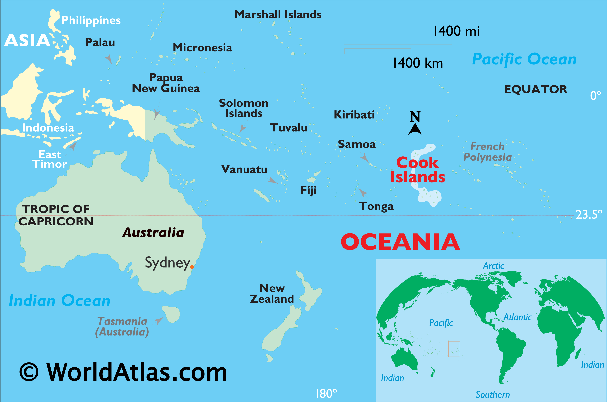
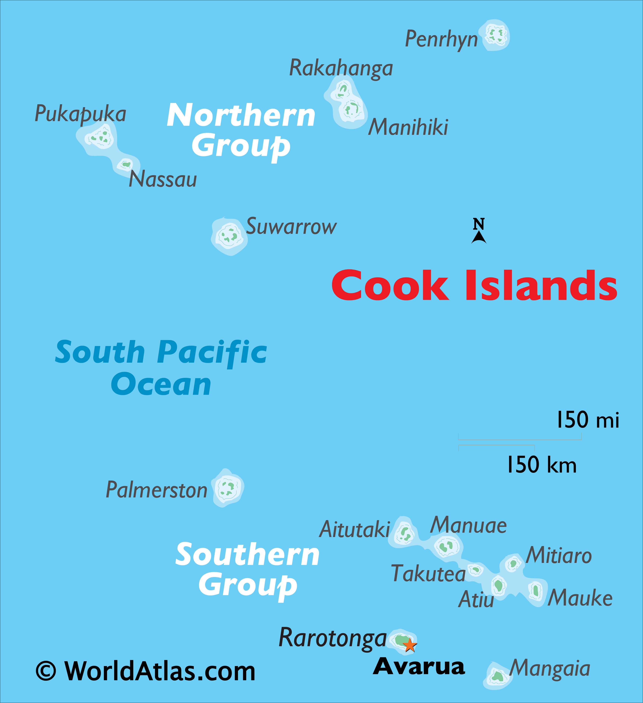
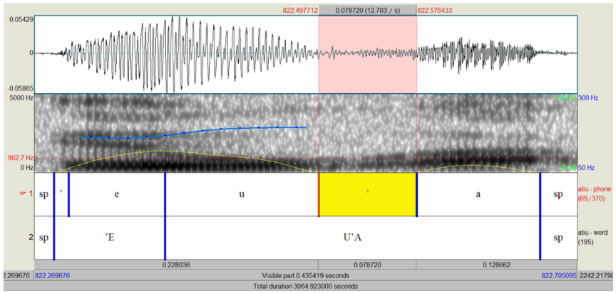
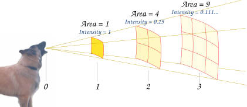
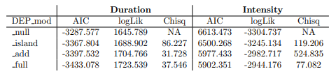
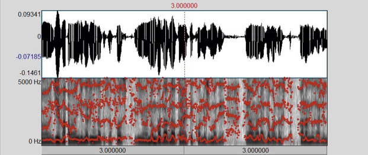
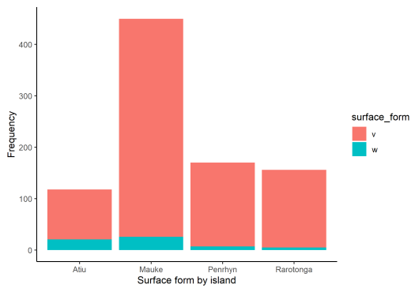

class: center, middle

# **Introduction**

### Kia orana kātoa! Ko Quartz tōku ingoa. 

### Kā tuatua au nō te Māori ꞌAvaiki Nui (Māori Kūki 'Āirani) i tēia rā.

### Meitaki, **Rolando Coto-Solano** and **Ake Nicholas**, with whom this project would not have been possible!

---
# The language: **Māori ꞌAvaiki Nui**

- Also known as <span style="color:green">Cook Islands Māori</span> (CIM)

- **Eastern Polynesian** language indigenous to the Realm of New Zealand

- VSO is the unmarked word order

- Closely related to, but definitely different from Aotearoa NZ Māori

--

- Classified as **Endangered** (Rarotonga) or **Vulnerable** (other islands) and there is little intergenerational transmission 😢 (Nicholas, 2018)

---
# Cook Islands Māori: Where?

.pull-left[
```{r, fig.align = "center", echo=FALSE, out.width="200%", fig.cap="Map of Oceania."}

```
]

.pull-right[
```{r, fig.align = "center", echo=FALSE, out.width="90%", fig.cap="Map of Cook Islands."}

```
]

```{r}
#| label: read-csv
#| echo: false
#| message: false
#| warning: false

library("tidyverse")
library("tidyr")
library("here")
library("lme4")
library("mgcv")
library("broom")
library("ggplot2")
library(knitr)
library(kableExtra)
library("corrplot")
library("vcd")
library("sjPlot")
library("lmerTest")
library("modelsummary")
theme_update(# axis labels
             axis.title = element_text(size = 16),
             # tick labels
             axis.text = element_text(size = 16),
             # title 
             title = element_text(size = 19))

source(here::here("libs", "libs.R"))

untidy_data <- read_csv(here("untidy_data", "cim-v-w-202410.csv"))

```

---

# The topic

It's known across both Aotearoa NZ Māori and CIM that sometimes people pronounce [v] as [w], but **it isn't clear to anyone who does this more and what conditions it!**

--

Today, I show my attempt at some statistical modeling of w/v tokens' phonetic features, and try to determine a pattern for the alternation.

--

# The questions

1. How does <b>duration</b> of w~v vary by island?

2. How does <b>intensity</b> of w~v vary by island? 

  - **Intensity:** a measure of the sound's power per unit area (you can think of it as loudness)

3. Does <b>voicing</b> of w~v vary by island? (determined by F0)

4. Which island(s) have more or less [w] tokens surfacing instead of [v]s? (determined by F2)

---

# Roadmap for today

1. Intro (the language, our questions)

2. The data

3. Duration and Intensity

4. Half-way summary 

5. F0 and F2

6. Conclusion (discussion, implications)

---

class: center, middle

# **The data**

### I work as a contract transcriber on a project documenting CIM, so I got this data from my supervisors (**Ake ē Rolando, meitaki!**)

---

# Raw data: how did they get all this data?

[PARADISEC corpus](https://catalog.paradisec.org.au/repository/SN1)

Force-aligned by phoneme in Praat (Boersma, P., & Weenink, D. 2024)

Praat TextGrids were extracted from Praat with the acoustic measurements (Coto-Solano et al. 2018)

```{r, fig.align = "center", echo=FALSE, out.width="65%", fig.cap="Praat TextGrid example (Coto-Solano et al. 2018)."}

```

---

## Raw data: SO MUCH....

```{r}
#| label: glimpse-cim
#| message: false
#| echo: false
#| warning: false

glimpse(untidy_data)

```


**Omg....**

---
## Raw data: values

- **Speaker:** just their initials (no 'id' column)

- **Island:**  either Atiu, Mauke, Penrhyn, or Rarotonga

- **Filename:** refers to the audio file this was extracted from

--

- **PreviousLabel**/**FollowingLabel:** phoneme that precedes/follows

- **Start**/**End:** the start and end times for that phoneme

- **Duration:** *total* duration of the phoneme

--

- **F0.point:** f0 measured in Hz at that percent of the phoneme's duration

- **F2_midpoint:** f2 measured in Hz at the midpoint of the phoneme

- **Intensity_midpoint:** intensity midpoint of the phoneme

### These are a lot of values here- we won't need all of them!


---
## Data overload: **focus on these ones!**

- **Speaker:** just their initials (no 'id' column)

- **Island:**  either Atiu, Mauke, Penrhyn, or Rarotonga

- **Duration:** *total* duration of the phoneme

--

- **F0.point:** f0 measured in Hz at that percent of the phoneme's duration

- **F2_midpoint:** f2 measured in Hz at the midpoint of the phoneme

- **Intensity_midpoint:** intensity midpoint of the phoneme

---

class: center, middle

# Part 1: **Duration**


---
# Duration by island: Tidy data

We will only keep the columns "speaker", "island", "word", and "duration" for this question.

```{r}
#| label: tidy-duration
#| echo: false
#| message: false
#| warning: false

tidy_dur <- untidy_data |>
  filter(TextGridLabel == "v") |>  
  arrange(island, Word) |>  
  select(speaker, island, word = Word, duration) |>
  write_csv(here("tidy_data", "tidy_dur.csv"))

```


```{r}
#| label: glimpse-duration
#| echo: false
#| warning: false
#| message: false


knitr::kable(head(tidy_dur), format = "html") %>%
  kable_styling() %>%
  column_spec(1:4, width = "1in") 

```

---
.pull-left[

# Duration by island: Plot


**Penrhyn**

- the <b>largest range</b> (whether you include that really high outlier or not) 

- <b>highest mean</b> 

**Mauke** and **Atiu**

- quite <b>similar ranges and means</b>

**Rarotonga** was the most compact

- the <b>smallest range</b>

- the <b>lowest mean</b>


```{r}
#| label: duration-plot
#| warning: false
#| message: false
#| echo: false

plot_dur <- tidy_dur |>
  ggplot() +
  aes(x = island, y = duration, color = island) +
  geom_boxplot() +
  labs(
    title = "Compare [v] duration by island",
    x = "Island",
    y = "Duration"
  ) 


# 2. Generate the base mosaic plot
#mosaicplot(tidy_dur, 
#           main = "Compare [v] duration by island",
#           xlab = "Island", 
#           ylab = "Duration", 
#           color = c("skyblue", "chocolate", "red", "green"))

#plot_dur <- xtabs(~island + duration, data = tidy_dur)
#mosaic(island, gp = shading_max, 
#            split_vertical = TRUE, 
#            main="Arthritis: [Treatment] [Improved]")

```

]

.pull-right[
```{r, fig.height=10, fig.width=9, fig.retina=3}
#| label: print-dur
#| echo: false
#| message: false
#| warning: false

print(plot_dur)

#explain model type - nested model comparison / lmer() - linear mixed-effects models (LMMs) fit to data where observations are grouped or nested, such as repeated measures, longitudinal data, or blocked experimental designs

```
]

---

.pull-left[
## Duration by island: Model

```{r}
#| label: mod-duration
#| echo: true
#| message: false
#| warning: false

mod_dur <- lmer(duration ~ island + (1|speaker) + (1|word), data = tidy_dur)

```


I used **linear mixed-effects models** ('lmer' in R) for the four phonetic features I'm investigating

- For duration and intensity I also did a nested model comparison ('anova' in R)

- The nested model comparison part serves to evaluate whether adding or removing parameters improves the model's ability to explain the data.

**Disclaimer:** I will not show you all parts of the nested model comparisons, because I don't think I'll have time! But I will briefly say their results.

]

--

.pull-right[
```{r}
#| label: print-dur-summary
#| echo: false
#| message: false
#| warning: false

tab_model(mod_dur, string.intercept = "island [Atiu]")

```
]

---

# Duration by island: Model

**P-values:** 

- Atiu (< 0.001), Mauke (0.906), Penrhyn (0.281), Rarotonga (0.206)

  - A p-value < 0.05 means no effect was observed
  
  - <b>Island had a large effect on duration!</b>

**Random effects:** all 0 except ICC (0.46) 

- <b>Intraclass correlation (ICC)</b>

  - Values < 0.5 indicate poor reliability, values 0.5--0.75 indicate moderate reliability, values 0.75--0.9 indicate good reliability, and values > 0.90 indicate excellent reliability

  - This wasn't an extremely reliable model

- <b>Standard deviation</b> was 0 


---
class: center, middle

# Part 2: **Intensity**

```{r, fig.align = "center", echo=FALSE, out.width="75%", fig.cap="Intensity is basically loudness."}

```

---

# Intensity by island: Tidy

For this one, we will keep the columns "speaker", "island", "word", and "intensity_midpoint" (renamed as "intensity")

```{r}
#| label: tidy-intensity
#| echo: false
#| warning: false
#| message: false

tidy_intense <- untidy_data |>
  filter(TextGridLabel == "v") |>  
  arrange(island, Word) |>  
  select(speaker, island, word = Word, intensity = intensity_midpoint) |>
  write_csv(here("tidy_data", "tidy_intense.csv"))

```

```{r}
#| label: glimpse-intense
#| echo: false
#| message: false
#| warning: false

#knitr::kable(head(tidy_intense), format = "html", column_spec(1:4, width="1in")) 

knitr::kable(head(tidy_intense), format = "html") %>%
  kable_styling() %>%
  column_spec(1:4, width = "1in") 

```

---

.pull-left[

# Intensity by island: Plot


Intensity **ranges were much larger** for all islands than they were for duration!

**Penrhyn**

- the <b>lowest mean intensity</b>

**Atiu, Mauke and Rarotonga**

- very <b>similar means</b>

**Atiu**

- intensity values were more <b>clustered</b> around the mean than the other islands

```{r}
#| label: intensity-by-island
#| warning: false
#| message: false
#| echo: false
#| out-width: "60%"

plot_intense <- tidy_intense |>
  ggplot() +
  aes(x = island, y = intensity, color = island) +
  geom_boxplot() +
  labs(
    title = "Compare [v] intensity by island",
    x = "Island",
    y = "Intensity"
  ) 

```
]

.pull-right[
```{r, fig.height=10, fig.width=9, fig.retina=3}
#| label: print-intensity-plot
#| echo: false
#| warning: false
#| message: false

print(plot_intense)

```
]

---

.pull-left[

# Intensity by island: Model

Another linear mixed effects model for intensity!

```{r}
#| label: mod-intensity
#| echo: true
#| message: false
#| warning: false

mod_intense <- lmer(intensity ~ island + (1|speaker) + (1|word), data = tidy_intense)

```

]


.pull-right[

```{r}
#| label: summary-intensity
#| echo: false
#| warning: false
#| message: false

tab_model(mod_intense, string.intercept = "island [Atiu]")


```
]

---

## Intensity by island: Model

**P-values:** 

- Atiu (< 0.001), Mauke (0.835), Penrhyn (0.609), Rarotonga (0.861)

  - a p-value < 0.05 means no effect was observed

  - island had a large effect on intensity values
  
**Random effects**

- standard deviation: 34.24 

  - data points were fairly spread out, not clustered around the mean

- Intraclass correlation (< 0.5 is poor reliability, > 0.9 is excellent reliability)

  - ICC was 0.8 so this model was much more reliable!!

---

class: center, middle

# Intensity and duration: Nested model comparison

```{r, fig.align = "center", echo=FALSE, out.width="50%"}

```

---

# Intensity and duration: Nested models

**Duration:**

- Were well-fit and accurate to the population, based on a very small <b>Akaike Information Criterion (AIC)</b> value and a large <b>log-likelihood (logLik)</b> value.

- The **island a speaker was from made the greatest difference in duration**

--

**Intensity:**

- The nested intensity model was not well-fit (based on a large AIC value and small logLik value)

- The greatest difference in the nested model comparison was for the model with all parameters *except word*. 

- Intensity varied more for **island and speaker**, and the word
was less relevant.

---

# Intensity and duration: Nested models

```{r, fig.align = "center", echo=FALSE, out.width="100%", fig.cap="Nested model summary (duration and intensity)."}

```

---

class: center, middle

# **Interim summary**

```{r, fig.align = "center", echo=FALSE, out.width="50%", fig.cap="Encouraging stock image."}

```

---

# Interim summary

### **Duration**

- Penrhyn has the longest **average** w~v durations and Rarotonga has the shortest

- Penrhyn also has the largest **range** of durations

- Atiu and Mauke have pretty similar **average** w~v durations

--

### **Intensity**

- Penrhyn has the **lowest mean** intensity midpoint (its entire range is lowest)

- Mauke and Rarotonga have pretty **large ranges**, but for Rarotonga the values are more concentrated around the mean (the box itself is smaller)

- Atiu has the **smallest range** for intensity and the values are concentrated around the mean 

- Atiu, Mauke and Rarotonga had fairly similar **means**

--

...Maybe Atiu doesn't vary as much because only one speaker contributed data for the Atiu portion? 

---

# Next half: **F0** and **F2**

- **[w]** *can* be voiceless and its **F0** is either super low or absent (I will assume < 100 Hz indicates more likelihood of voicelessness)

- **[v]** is voiced, so **F0** is always there and is higher than for [w]

--

- **[w]** has a **lower F2** than [v] (my assumed cutoff point will be 850 Hz)

**Disclaimer:** this may not exactly correspond to the perceptual boundary between [w] and [v] in the language- this hasn't been tested


---

class: center, middle

# Part 3: **F0** 

```{r, fig.align = "center", echo=FALSE, out.width="75%"}

```


---
# F0 by island: Tidy

We will split the "f0_50.point" column into "percent" and "f0", and keep the columns "speaker", "island", "word", "d0", and "duration" for this question.

```{r}
#| label: tidy-f0
#| echo: false
#| message: false
#| warning: false

tidy_f0 <- untidy_data |>
  filter(TextGridLabel == "v") |>
  pivot_longer(
    cols = c("f0_50.point"), 
    names_to = "percent",
    values_to = "f0"
  ) |>
  arrange(island, Word) |>  
  select(speaker, island, word = Word, f0, duration) |>
  write_csv(here("tidy_data", "tidy_f0.csv"))

```

- I limited F0 to *F0 at 50%* to limit **autocorrelation.** 

  - accidentally associating duration for a single word with too many "f0" values

--

```{r}
#| label: glimpse-f0
#| echo: false
#| message: false
#| warning: false

knitr::kable(head(tidy_f0), format = "html") %>%
  kable_styling() %>%
  column_spec(1:4, width = "1in") 
```


---

class: center, middle

```{r}
#| label: plot-f0
#| echo: false
#| message: false
#| warning: false

f0_plot <- tidy_f0 |>
  ggplot() + 
  aes(x = duration, y = f0, color = speaker) +
  geom_point() +
  geom_smooth(
    method="glm",
    color="black",
    method.args = list(family = "poisson")
  ) +
  facet_wrap(.~island, scales = 'free', nrow = 2) +
  theme(
    # Resize the facet header/strip text
    strip.text = element_text(size = 10, face = "bold"),
    # Resize x and y axis tick values
    axis.text.x = element_text(size = 10),
    axis.text.y = element_text(size = 10),
    # Resize main axis titles
    axis.title = element_text(size = 12)
  ) +
  labs(
    title = "Compare F0 across islands", 
    x = "Duration", 
    y = "F0 (Hz)"
  ) 
```

```{r, out.width="62%", out.height="62%"}
#| label: print-f0-plot
#| echo: false
#| message: false
#| warning: false

print(f0_plot)

```

---

# F0 by island: Plot

**Atiu**

- lowest F0, generally around 150 Hz

- probably higher rates of voiceless tokens ("w")?

**Mauke**

- F0 was generally higher (150-200 Hz), but there were definitely several points lower than 100 Hz too

**Penrhyn**

- large range in F0, but mostly ranging from 100-175 Hz

**Rarotonga**

- large range, generally from 150-250 Hz

The islands with a nonsignificant number of tokens <b> < 100 Hz are Atiu and Mauke</b>, so I would guess that these two islands are more likely to pronounce "v" as [w]

---

.pull-left[
# F0 by island: Model

Another linear mixed effects model for F0! 

```{r}
#| label: mod-f0
#| echo: true
#| message: false
#| warning: false

mod_f0 <- lmer(f0 ~ island + (1|speaker) + (1|word), data = tidy_f0)

```

]

.pull-right[

```{r}
#| label: summarize-f0
#| echo: false
#| message: false
#| warning: false

tab_model(mod_f0, string.intercept = "island [Atiu]")

```
]

---

# F0 by island: Model

**P-values:**

- Atiu (< 0.001), Mauke (0.378), Penrhyn (0.928), Rarotonga (0.067)

  - A p-value < 0.05 means no effect was observed

  - There was an observed effect in voicing for all islands except Atiu, but a <b>greater effect for Mauke and Penrhyn</b> (huge effect)

**Random effects:**

- <b>Standard deviation</b> 822.23

  - Data was very spread out from the mean

- <b>Intraclass correlation</b> (< 0.5 is poor reliability, > 0.9 is excellent reliability)

  - ICC was 0.47, so this was *not* a very reliable model 


---

class: center, middle

# Part 4: **F2**

### w or v?

---

# F2 by island: Tidy

We keep the values for "speaker", "island", "word", and "F2_midpoint" which is renamed as "f2".

```{r}
#| label: tidy-f2
#| echo: false
#| message: false
#| warning: false

tidy_f2 <- untidy_data |>
  filter(TextGridLabel == "v") |>
  arrange(island, Word) |>  
  select(speaker, island, word = Word, f2 = F2_midpoint) |>
  write_csv(here("tidy_data", "tidy_f2.csv"))

```

```{r}
#| label: glimpse-f2
#| echo: false
#| message: false
#| warning: false

knitr::kable(head(tidy_f2), format = "html") %>%
  kable_styling() %>%
  column_spec(1:4, width = "1in") 

```

---

.pull-left[

# F2 by island: Plot 


```{r}
#| label: plot-f2
#| echo: false
#| message: false
#| warning: false

f2_plot <- tidy_f2 |>
  ggplot() +
  aes(x = island, y = f2, color = island) +
  geom_boxplot() +
  labs(
    title = "Compare [v] F2 by island",
    x = "Island",
    y = "F2 (Hz)"
  )

```

**Rarotonga**

- <b>highest average</b> 

**Atiu** 

- The most <b>clustered</b> around the mean

- <b>Lowest average</b> F2

**Penrhyn and Mauke** had the <b>largest ranges</b> in F2 values

<b>Lowest values</b> were in **Atiu and Mauke**

]

.pull-right[
```{r, fig.height=10, fig.width=9, fig.retina=3}
#| label: print-f2-plot
#| echo: false
#| warning: false
#| message: false

print(f2_plot)

```
]

---

.pull-left[
# F2 by island: Model 

Another linear mixed effects model for F2.

```{r}
#| label: mod-f2
#| echo: true
#| message: false
#| warning: false

mod_f2 <- lmer(f2 ~ island + (1|speaker) + (1|word), data = tidy_f2)

```

**P-values:** 

- all < 0.001, so <b>no effect</b> was observed for any island

**Random effects:**

- Standard deviation was huge (155,389.93), so data was ***extremely*** spread out 

- Intraclass correlation (0.21) indicated this was the least reliable model

]

.pull-right[
```{r}
#| label: summary-f2
#| message: false
#| echo: false
#| warning: false

tab_model(mod_f2, string.intercept = "island [Atiu]")


```
]

---

# F2 by island: Counts

I manually calculated the percentages of [w] surfacing for each island
.pull-left[
- **Atiu** data had [w] **17.80%** of the time

- **Mauke** data had [w] **5.75%** of the time
]
.pull-right[
- **Penrhyn** data had [w] **4.12%** of the time

- **Rarotonga** data had [w] **3.21%** of the time
]
```{r, fig.align = "center", echo=FALSE, out.width="50%"}

```


---

# Formant results 

### Great, so what does this all mean?

--

### Voicing (F0)

- Island had an effect on F0! 

- <b>Mauke and Penrhyn had the largest effect</b>

--

### The w~v question 

- **Recall** that a 'low f2' indicating [w] is < 850 Hz

--

- **all** of these 4 islands have *some* instances of [w]

- their means are all higher than this cut-off, so they all *averagely* surface as [v]

--

- But, Atiu has the most [w]s surfacing on average (Atiu's mean is lowest)

---

class: center, middle

# Discussion & Implications

---

# Discussion

Island had the greatest influence on **duration**

- longest duration was Penrhyn, shortest was Rarotonga

--

Island and speaker both influenced **intensity**

- Penrhyn had lowest mean

- Atiu, Mauke and Rarotonga had similar means

--

Island had an effect on **F0 values** for all islands except Atiu, but a greater effect for Mauke and Penrhyn

- Mauke and Atiu had the most tokens < 150 Hz

--

Island didn't have an effect on **F2 values** in the F2 model...

- But the **frequency** information revealed that "w" is pronounced a greater percentage of the time in Atiu and the least in Rarotonga

---

# Implications? Conclusion

The "word" parameter didn't influence things in any of these models, so it's likely that this is **not solely a phonologically-conditioned alternation**.

--

"Island" seemed to affect everything *except* F2 directly

--

**Voicing** might be affecting whether "v" surfaces as "w"! 

- <b>Further investigation</b> into the alternation should look at **voicing in the phonology**

- The islands with higher rates of "w" (Atiu and Mauke) might have phonological conditioning while the other islands might have free variation. 

- Zooming in on the data for Atiu and Mauke might be more beneficial

---

class: middle, center

# <span style="color:green">Meitaki!</span>

# <span style="color:blue">Ngā mihi nui!</span>

# <span style="color:red">Thank you!</span>

---

# References

Boersma, P., & Weenink, D. (2024). Praat: doing phonetics by computer [computer program]. Version 6.4, retrieved from https://praat.org. (Available at https://praat.org)

Coto-Solano, R., Nicholas, S. A., & Wray, S. (2018). Development of natural language processing tools for Cook Islands Māori. In Proceedings of Australasian Language Technology Association
Workshop (pp. 26–33).

Nicholas, S. A. (2018). Language contexts: Te Reo Māori o Te Pae Tonga o Te Kuki Airani also known as Southern Cook Islands Māori. Language Documentation and Description, 15, 36-64. doi: https://doi.org/10.25894/ldd138.

Nicholas, S. A. (2012). Te vairanga tuatua o te te reo māori o te pae tonga: Cook Islands Māori (southern dialects). catalog.paradisec.org.au. Retrieved from https://dx.doi.org/
10.4225/72/56E9793466307 (Collection SN1)

Phonetics and phonology. (2014). The Education University of Hong Kong, Department of Linguistics and Modern Language Studies. Retrieved from https://corpus.eduhk.hk/english pronunciation/index.php/3-2-acoustic-aspects-of-consonants/

R Core Team. (2024). R: A language and environment for statistical computing [Computer software manual]. Vienna, Austria. Retrieved from https://www.R-proj

---

class: center, middle

# Running each variable by *person* instead of *island*

---

.pull-left[
# Duration by person

```{r}
#| label: mod-duration-psn
#| echo: false
#| message: false
#| warning: false

mod_dur_psn <- lmer(duration ~ speaker + (1|island) + (1|word), data = tidy_dur)

plot_dur_psn <- tidy_dur |>
  ggplot() +
  aes(x = speaker, y = duration, color = island) +
  geom_boxplot() +
  labs(
    title = "Compare [v] duration by speaker",
    x = "Speaker",
    y = "Duration"
  )

print(plot_dur_psn)

```
]


.pull-right[
```{r}
#| label: print-dur-psn-summary
#| echo: false
#| message: false
#| warning: false

#summary(mod_dur_psn)

tab_model(mod_dur_psn, string.intercept = "speaker [AAN]")


```
]


---

.pull-left[

# Intensity by person

```{r}
#| label: mod-intense-psn
#| echo: false
#| message: false
#| warning: false

mod_intense_psn <- lmer(intensity ~ speaker + (1|island) + (1|word), data = tidy_intense)

plot_intense_psn <- tidy_intense |>
  ggplot() +
  aes(x = speaker, y = intensity, color = island) +
  geom_boxplot() +
  labs(
    title = "Compare [v] intensity by speaker",
    x = "Speaker",
    y = "Intensity"
  )

print(plot_intense_psn)

```
]


.pull-right[
```{r}
#| label: print-intense-psn-summary
#| echo: false
#| message: false
#| warning: false

#summary(mod_intense_psn, string.intercept = "speaker [AAN]")
tab_model(mod_intense_psn, string.intercept = "speaker [AAN]")


```
]

---

.pull-left[

# F0 by person 

```{r}
#| label: mod-f0-psn
#| echo: false
#| message: false
#| warning: false

mod_f0_psn <- lmer(f0 ~ speaker + (1|island) + (1|word), data = tidy_f0)

plot_f0_psn <- tidy_f0 |>
  ggplot() +
  aes(x = speaker, y = f0, color = island) +
  geom_boxplot() +
  labs(
    title = "Compare [v] F0 by speaker",
    x = "Speaker",
    y = "F0"
  )

print(plot_f0_psn)

```
]


.pull-right[
```{r}
#| label: print-f0-psn-summary
#| echo: false
#| message: false
#| warning: false

#summary(mod_f0_psn, string.intercept = "speaker [AAN]")
tab_model(mod_f0_psn, string.intercept = "speaker [AAN]")


```
]

---

.pull-left[

# F2 by person

```{r}
#| label: mod-f2-psn
#| echo: false
#| message: false
#| warning: false

mod_f2_psn <- lmer(f2 ~ speaker + (1|island) + (1|word), data = tidy_f2)

plot_f2_psn <- tidy_f2 |>
  ggplot() +
  aes(x = speaker, y = f2, color = island) +
  geom_boxplot() +
  labs(
    title = "Compare [v] F2 by speaker",
    x = "Speaker",
    y = "F2"
  )

print(plot_f2_psn)

```
]


.pull-right[
```{r}
#| label: print-f2-psn-summary
#| echo: false
#| message: false
#| warning: false

#summary(mod_f2_psn, string.intercept = "speaker [AAN]")
tab_model(mod_f2_psn, string.intercept = "speaker [AAN]")

```
]

---


```{r}
#| label: flextable
#| echo: false
#| message: false
#| warning: false

modelsummary::msummary(list("Duration" = mod_dur_psn, 
                            "Intensity" = mod_intense_psn,
                            "F0" = mod_f0_psn, 
                            "F2" = mod_f2_psn),
                       output = 'flextable', 
                       caption = "Each Variable by Person")

```

---

# Corrplot stuff

```{r}
#| label: dur-psn-corrplot
#| echo: false
#| message: false
#| warning: false


```


